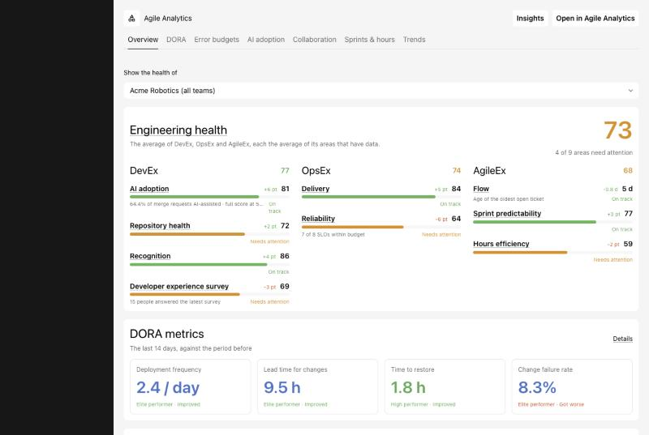
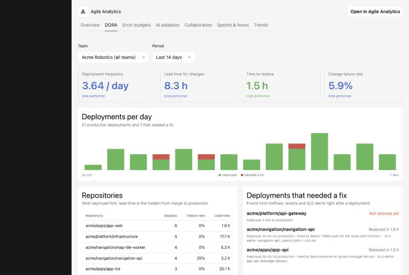
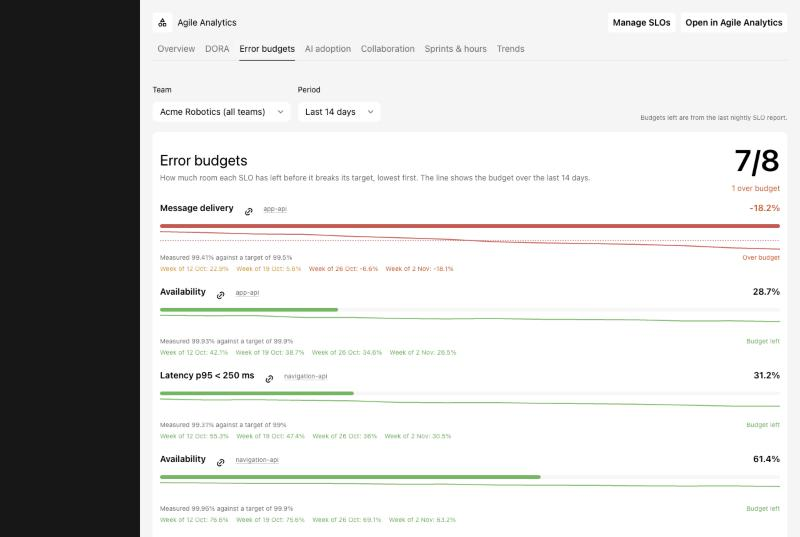
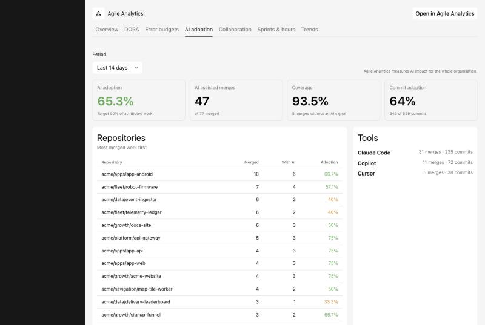

# Agile Analytics for Backstage

Bring [Agile Analytics](https://www.agileanalytics.cloud) into your own
Backstage: engineering health, DORA metrics, SLOs and error budgets, AI
adoption, collaboration, sprints and trends, for the whole organisation or a
single team, plus cards on your catalog's entity pages.



| Package                                                                                                                                            | What it is                                                         |
| -------------------------------------------------------------------------------------------------------------------------------------------------- | ------------------------------------------------------------------ |
| [`@zensoftwarenl/backstage-plugin-agile-analytics`](https://www.npmjs.com/package/@zensoftwarenl/backstage-plugin-agile-analytics)                 | The frontend plugin: the Agile Analytics page and the entity cards |
| [`@zensoftwarenl/backstage-plugin-agile-analytics-backend`](https://www.npmjs.com/package/@zensoftwarenl/backstage-plugin-agile-analytics-backend) | The backend plugin: holds your API key and serves the frontend     |
| [`@zensoftwarenl/backstage-plugin-agile-analytics-common`](https://www.npmjs.com/package/@zensoftwarenl/backstage-plugin-agile-analytics-common)   | Types shared by both, installed with them                          |

## Requirements

- Backstage **1.56 or later**, on the
  [new frontend system](https://backstage.io/docs/frontend-system/) and the
  [new backend system](https://backstage.io/docs/backend-system/). Version
  2.x does not support the legacy frontend system (`createApp` from
  `@backstage/app-defaults`). Use 0.2.x there, or migrate your app first.
- An Agile Analytics organisation and an API key for it. You don't have one
  yet? Try the plugin in [demo mode](#demo-mode) first.

## What you get

A page at `/agile-analytics` with a tab per area. The team and period are
kept in the URL, so every view can be linked to.

- **Overview**: the engineering health score with its DevEx, OpsEx and
  AgileEx parts, the latest DORA metrics and recent signals.
- **DORA**: deployment frequency, lead time for changes, time to restore and
  change failure rate against the DORA benchmarks, per day, repository and
  team, and the deployments that needed a fix.
- **Error budgets**: every SLO, lowest error budget first, with the budget
  over the period and per week.
- **AI adoption**: how much merged work AI helped with, per repository and
  tool, and how it affects speed, quality and cost.
- **Collaboration**: code review flow, repository ownership, bus factors and
  how widely kudos are shared.
- **Sprints & hours**: sprint predictability, work in progress and hours
  booked per project.
- **Trends**: DORA and AI adoption per week over 13, 26 or 52 weeks.

Three entity cards:

- **Error budget**: the SLOs of one service, on entities with the
  `agileanalytics.cloud/service` annotation.
- **Team error budgets**: on group pages, the services the group and its
  sub-teams own, with the SLOs and error budgets of each.
- **Delivery**: the DORA metrics, ownership and AI adoption of one
  repository, on entities linked to a repository.

| DORA                                   | Error budgets                                            | AI adoption                                          |
| -------------------------------------- | -------------------------------------------------------- | ---------------------------------------------------- |
|  |  |  |

## Install

From your Backstage root:

```bash
yarn --cwd packages/app add @zensoftwarenl/backstage-plugin-agile-analytics
yarn --cwd packages/backend add @zensoftwarenl/backstage-plugin-agile-analytics-backend
```

Add the backend plugin to `packages/backend/src/index.ts`:

```ts
backend.add(import('@zensoftwarenl/backstage-plugin-agile-analytics-backend'));
```

The frontend plugin is picked up by
[feature discovery](https://backstage.io/docs/frontend-system/architecture/app#feature-discovery)
when your `app-config.yaml` has `app.packages: all`. Otherwise add it to your
app's features:

```ts
// packages/app/src/App.tsx
import agileAnalyticsPlugin from '@zensoftwarenl/backstage-plugin-agile-analytics';

const app = createApp({
  features: [
    // ...
    agileAnalyticsPlugin,
  ],
});
```

## Configure

```yaml
# app-config.yaml
agileAnalytics:
  orgHash: ${AGILE_ANALYTICS_ORG_HASH}
  apiKey: ${AGILE_ANALYTICS_API_KEY}
```

| Key                              | Default                                 | What it does                                                                                                                                                   |
| -------------------------------- | --------------------------------------- | -------------------------------------------------------------------------------------------------------------------------------------------------------------- |
| `agileAnalytics.orgHash`         | required                                | Your organisation in Agile Analytics. Backend only.                                                                                                            |
| `agileAnalytics.apiKey`          | required                                | An Agile Analytics API key. Secret: only the backend reads it, and it is redacted from logs.                                                                   |
| `agileAnalytics.authHeader`      | `api-key`                               | How the key is sent: `api-key` (a base64 `Api-Key` header) or `bearer` (`Authorization: Bearer`). Leave it unless Agile Analytics support tells you otherwise. |
| `agileAnalytics.baseUrl`         | `https://api.prod.agileanalytics.cloud` | The Agile Analytics API.                                                                                                                                       |
| `agileAnalytics.cacheTtlMinutes` | `15`                                    | How long the backend caches responses. Agile Analytics refreshes its reports nightly.                                                                          |
| `agileAnalytics.appUrl`          | `https://www.prod.agileanalytics.cloud` | The Agile Analytics web app that the links from Backstage open. The only key the frontend reads.                                                               |
| `agileAnalytics.demo`            | `false`                                 | Serve made-up data instead of calling Agile Analytics. See [demo mode](#demo-mode).                                                                            |

### Where to find the API key and orgHash

Sign in to [Agile Analytics](https://www.prod.agileanalytics.cloud) as an
admin of your organisation.

- **API key**: _Settings → API key_
  ([direct link](https://www.prod.agileanalytics.cloud/settings/api-key)).
  Create a key for Backstage and keep it in your secret store. Don't put it
  in `app-config.yaml` itself.
- **orgHash**: _Settings → Organisation_
  ([direct link](https://www.prod.agileanalytics.cloud/settings/organisation)).

### Security

The API key reads all data of your organisation, so it never leaves the
backend:

- `apiKey` is marked `@visibility secret`, and `orgHash` is not visible to
  the frontend.
- The browser only talks to `/api/agile-analytics` on your own Backstage
  backend.
- Those routes are covered by Backstage's default auth policy: only
  signed-in users and other Backstage services can call them.
- The backend exposes a fixed set of read-only routes. It is not a general
  proxy to the Agile Analytics API.

## Link your catalog

Annotations tell the entity cards which Agile Analytics data belongs to an
entity:

```yaml
# catalog-info.yaml
apiVersion: backstage.io/v1alpha1
kind: Component
metadata:
  name: checkout-api
  annotations:
    # The service, as named on its SLOs in Agile Analytics: shows the Error budget card
    agileanalytics.cloud/service: checkout-api
    # The repository, as its path on the git host: shows the Delivery card
    agileanalytics.cloud/repository: acme/shop/checkout-api
spec:
  type: service
  owner: group:checkout-team
```

| Annotation                        | Card               | Notes                                                                                                                                           |
| --------------------------------- | ------------------ | ----------------------------------------------------------------------------------------------------------------------------------------------- |
| `agileanalytics.cloud/service`    | Error budget       | The service name on the SLOs in Agile Analytics, matched case-insensitively.                                                                    |
| `agileanalytics.cloud/repository` | Delivery           | Optional when the entity already has `github.com/project-slug` or `gitlab.com/project-slug`. When it is not set, those are used, in that order. |
| none on the group                 | Team error budgets | Lists the components the group and its sub-teams own, through `spec.owner`. Those with `agileanalytics.cloud/service` show their SLOs.          |

To move a card, or turn it or the page off, configure its extension in
`app-config.yaml`:

```yaml
app:
  extensions:
    - entity-card:agile-analytics/error-budget
    - entity-card:agile-analytics/team-error-budgets: false
    - entity-card:agile-analytics/delivery
    - page:agile-analytics
```

For the TypeScript API, the package also exports
`isAgileAnalyticsServiceAvailable`, `isAgileAnalyticsRepositoryAvailable`
and the annotation names.

## Demo mode

To see the plugin without an Agile Analytics account, or for screenshots and
demos, set:

```yaml
agileAnalytics:
  demo: true
```

The backend then serves made-up data of a fictional company, Acme Robotics,
and calls nothing. `orgHash` and `apiKey` aren't needed. The backend logs a
warning at startup so demo mode can't go unnoticed in production.

## Upgrading from 0.2.x

2.0.0 is a rewrite.

1. Install the backend plugin and add it to your backend (see
   [Install](#install)). The frontend no longer calls Agile Analytics
   itself.
2. Keep `agileAnalytics.orgHash` and `agileAnalytics.apiKey`. They are now
   read by the backend only, so remove any `frontend` visibility you added.
3. Move your app to the new frontend system. Then remove the
   `<Route path="/agile-analytics" element={<AgileAnalyticsPage />} />`
   route and the sidebar item, because the page comes with the plugin.
4. The Highcharts-based pages, the kudos page and the stock pages are gone.
   Kudos show as counts on the Collaboration tab.

## Development

This repo is a Yarn workspace with the three packages under `plugins/`.

```bash
yarn install
yarn tsc && yarn lint:all && yarn test:all && yarn build
```

To run the plugin locally with demo data, run `yarn start` in
`plugins/agile-analytics-backend` and in `plugins/agile-analytics`. Both
read the root `app-config.yaml`.

Releases: add a changeset with `yarn changeset`. The three packages share
one version. Pushing a `vX.Y.Z` tag publishes them to npm, see
[`.github/workflows/publish.yml`](.github/workflows/publish.yml).

ZEN Software develops the plugin in its own Backstage first and syncs it
here. [AGENTS.md](AGENTS.md) describes how.

## Support

Questions and bugs: [GitHub issues](https://github.com/zensoftwarenl/backstage-plugin-agile-analytics/issues)
or your Agile Analytics contact.

## License

[Apache-2.0](LICENSE)
