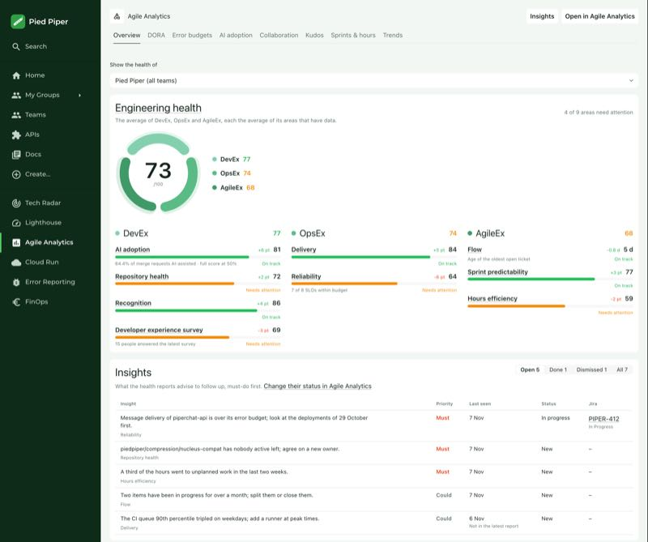

# Agile Analytics for Backstage

The frontend plugin that brings [Agile Analytics](https://www.agileanalytics.cloud)
into Backstage: a page with engineering health, DORA, error budgets, AI
adoption, collaboration, kudos, sprints and trends, and entity cards for services,
repositories and teams.



It needs
[`@zensoftwarenl/backstage-plugin-agile-analytics-backend`](https://www.npmjs.com/package/@zensoftwarenl/backstage-plugin-agile-analytics-backend),
which keeps your Agile Analytics API key on the server. Requires Backstage
1.56 or later on the new frontend and backend systems.

```bash
yarn --cwd packages/app add @zensoftwarenl/backstage-plugin-agile-analytics
yarn --cwd packages/backend add @zensoftwarenl/backstage-plugin-agile-analytics-backend
```

```ts
// packages/backend/src/index.ts
backend.add(import('@zensoftwarenl/backstage-plugin-agile-analytics-backend'));
```

```yaml
# app-config.yaml
agileAnalytics:
  orgHash: ${AGILE_ANALYTICS_ORG_HASH}
  apiKey: ${AGILE_ANALYTICS_API_KEY}
```

The frontend plugin is found by feature discovery, or can be added to your
app's `features`. To try it without an account, set `agileAnalytics.demo: true`.

**[Full documentation](https://github.com/zensoftwarenl/backstage-plugin-agile-analytics#readme)**: configuration, where to find your API
key and orgHash, entity annotations, demo mode and upgrading from 0.2.x.
